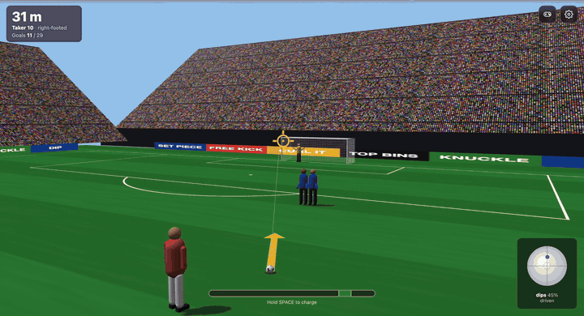

# Set Piece

A free-kick shooting game for the browser, built with Three.js. Aim a reticle at the goal, pick a contact point on the ball for curl, dip or a knuckleball, then time the power meter to beat a jumping wall and a goalkeeper.



## Setup

Requires [Node.js](https://nodejs.org) 20 or newer.

```bash
npm install
```

## Launch

```bash
npm run dev
```

Open the URL Vite prints (usually http://localhost:5173). Click the gamepad icon in the top-right corner for the controls, and the gear icon for settings such as wall height, wall jumping and goalkeeper skill.

Other commands:

```bash
npm test         # unit tests for the physics, shot model, wall and keeper
npm run build    # type-check and produce a production build in dist/
npm run preview  # serve the production build locally
```

## License

[MIT](LICENSE)
